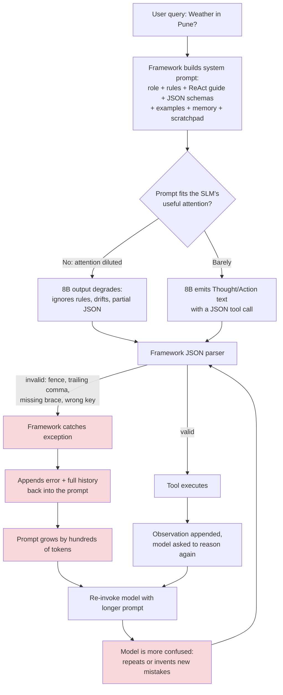
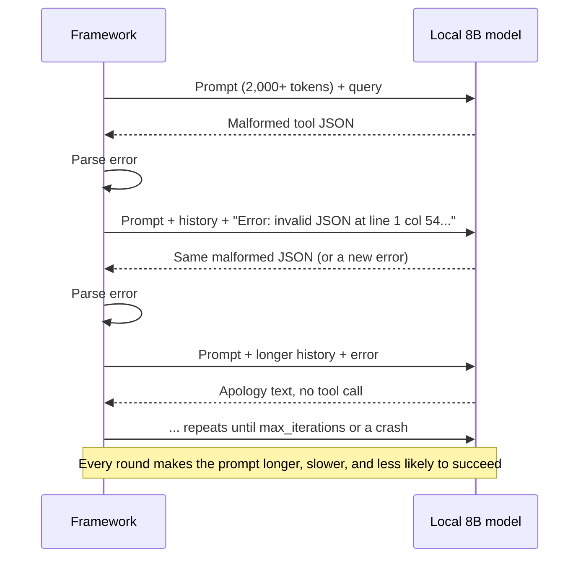
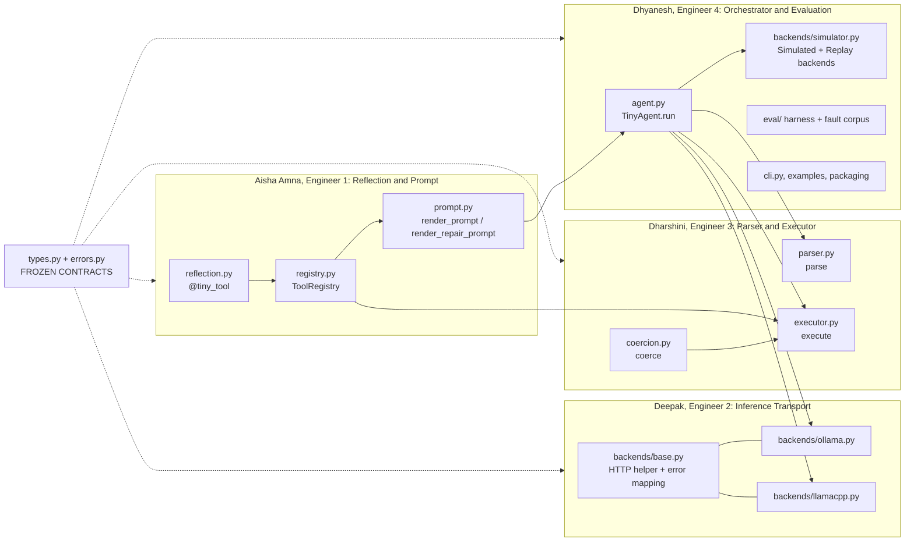
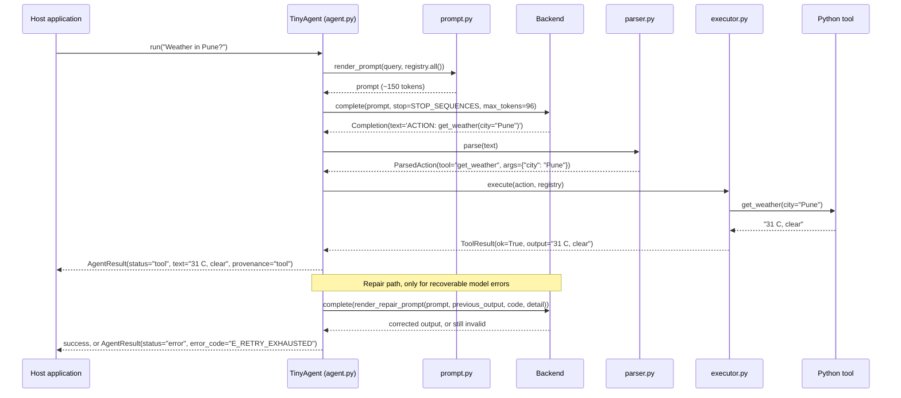
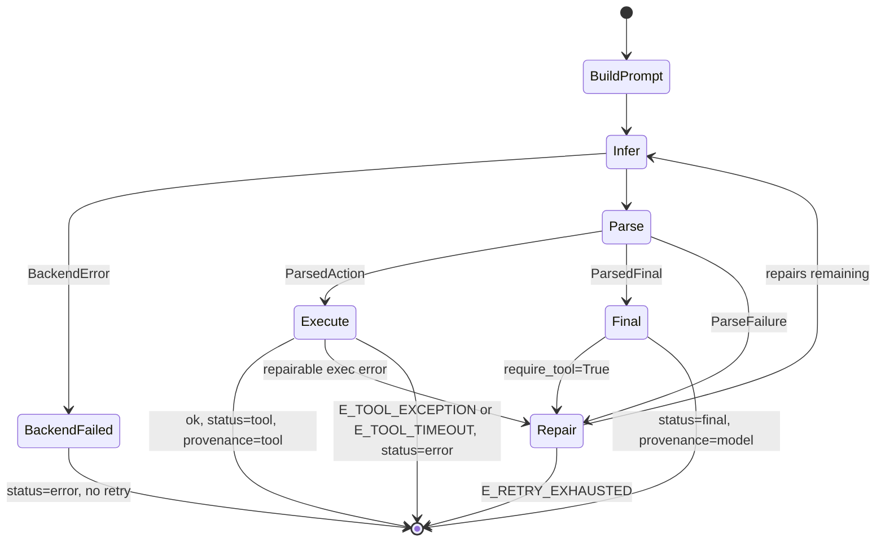
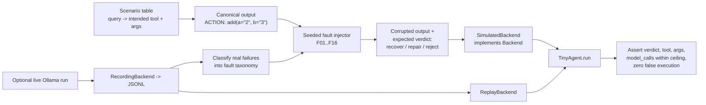

# TinyAgent: Architecture, Problem Analysis, and Solution Design

| Field          | Value                                                                                                                                                                        |
| -------------- | ---------------------------------------------------------------------------------------------------------------------------------------------------------------------------- |
| Document       | TinyAgent System Architecture (ARCH-000)                                                                                                                                     |
| Version        | 1.0                                                                                                                                                                          |
| Status         | Sprint baseline. Interface contracts in Section 8 are FROZEN after Phase 0.                                                                                                  |
| Audience       | All four engineers, reviewers, demo judges                                                                                                                                   |
| Team           | Aisha Amna (Engineer 1), Deepak (Engineer 2), Dharshini (Engineer 3), Dhyanesh (Engineer 4)                                                                                  |
| Companion PRDs | [PRD-01](prd/PRD-01-Reflection-Prompt-Aisha.md), [PRD-02](prd/PRD-02-Inference-Transport-Deepak.md), [PRD-03](prd/PRD-03-Parser-Executor-Dharshini.md), [PRD-04](prd/PRD-04-Orchestrator-Evaluation-Dhyanesh.md) |

---

## 1. Executive Summary

TinyAgent is a zero-dependency Python library that lets a 7B/8B local Small Language Model (SLM), served by Ollama or llama.cpp, reliably call Python functions.

Agent frameworks such as CrewAI, AutoGen, and LangGraph were designed around frontier cloud models. They assume the model can follow long system prompts, emit valid JSON, and recover from its own errors through multi-turn reasoning. A local 8B model does not meet these assumptions, which causes context exhaustion, JSON parse crashes, and retry loops that do not end.

TinyAgent treats the SLM as a **deterministic router**, not a reasoner. Each query results in one bounded decision: call one registered tool with arguments, or return a final answer. The design rests on five mechanisms:

1. **Code reflection** (`@tiny_tool`) builds a compact tool schema from Python signatures. Developers do not write JSON Schema.
2. **Linear prompt injection** sends one short prompt containing the tool list, the output grammar, and the query.
3. **Native local inference** makes a single HTTP POST with temperature `0.0`, a fixed seed, and stop sequences.
4. **Regex parsing** reads a one-line grammar (`ACTION: tool(arg="v")` or `FINAL: text`). The model never produces JSON.
5. **Allowlisted dynamic execution** runs only registered functions, coerces and validates every argument, and returns clean text.

The number of model calls per query has a hard ceiling of `1 + max_repairs`, where `max_repairs` is 0, 1, or 2 (default 1). Infinite loops are structurally impossible.

---

## 2. The Problem in Detail

### 2.1 The hidden assumption of cloud frameworks

Cloud agent frameworks assume that **the model is the reliability layer**. When something is ambiguous, the framework adds more instructions. When output is malformed, it shows the model the error and asks again. This works with GPT-4o class models, which have long-context attention, strong instruction following, and structured-output skills learned in training.

An 8B model running locally has:

- a smaller effective attention budget, so instruction following degrades as the prompt grows,
- weaker JSON grammar adherence, especially with nested schemas,
- weak self-correction: showing it its own error tends to make it repeat the error,
- slow inference on consumer CPU/GPU, so every extra token and every extra call costs seconds.

### 2.2 Problem architecture: how a cloud framework fails on an SLM



The red path is a **positive feedback loop**: each failure makes the next prompt longer, which makes the next failure more likely. Frameworks cap this with `max_iterations` settings, but the defaults are tuned for cloud models. When each iteration on a local 8B model costs several seconds of CPU/GPU time, a "bounded" loop still makes the application unusable.

### 2.3 Failure mode 1: prompt bloat and context exhaustion

A typical framework prompt stacks several layers before the user's question appears:

| Layer                | Typical contents                                                         | Effect on an 8B model                               |
| -------------------- | ------------------------------------------------------------------------ | --------------------------------------------------- |
| Role/persona         | "You are a helpful expert agent who..."                                  | Low value, consumes attention                       |
| Behavioural rules    | 10-30 imperative rules                                                   | Rules late in the list get ignored                  |
| Reasoning protocol   | Thought / Action / Action Input / Observation format with examples       | Model imitates the format but loses the task        |
| Tool schemas         | Full JSON Schema per tool: types, descriptions, required arrays, nesting | Largest cost; grows linearly with tool count        |
| History / scratchpad | Prior turns and observations                                             | Grows every iteration                               |
| User query           | The actual question                                                      | Placed last, often a small fraction of total tokens |

The problem is the ratio of signal to boilerplate. The user query becomes a small fraction of the context, and a small model spends its limited capacity on framework text.

**TinyAgent target:** base prompt of at most 120 estimated tokens plus at most 40 estimated tokens per tool (Section 9).

### 2.4 Failure mode 2: the JSON hallucination trap

Frameworks expect output such as:

```json
{"tool": "get_weather", "arguments": {"city": "Pune"}}
```

Local 8B models commonly produce variants like these:

| Observed variant | Example                                                   | Result in a JSON-first framework             |
| ---------------- | --------------------------------------------------------- | -------------------------------------------- |
| Markdown fence   | output wrapped in a json code fence                       | `json.loads` fails                         |
| Prose preamble   | `Sure! Here is the call: {...}`                         | `json.loads` fails                         |
| Missing bracket  | `{"tool": "get_weather", "arguments": {"city": "Pune"}` | `JSONDecodeError`                          |
| Trailing comma   | `{"city": "Pune",}`                                     | `JSONDecodeError`                          |
| Single quotes    | `{'city': 'Pune'}`                                      | `JSONDecodeError`                          |
| Hallucinated key | `{"location": "Pune"}`                                  | Schema error or `TypeError` inside the tool |
| Wrong nesting    | `{"get_weather": {"city": "Pune"}}`                     | `KeyError`                                 |

JSON requires balanced nesting across many tokens, and one wrong token anywhere invalidates the whole document. A flat, one-line function-call syntax has far fewer structural tokens, and a tolerant regex can recover many near misses that a strict JSON parser must reject.

### 2.5 Failure mode 3: infinite loop death spirals



Three factors make this worse on local hardware:

1. **Errors are fed back verbatim.** Stack traces and parser messages are noise to a small model.
2. **Context grows every round.** This degrades exactly the capability needed to recover.
3. **Compute is local and serial.** Each round blocks the user's machine, and long runs exhaust memory or time out the host application.

### 2.6 Root cause

All three failures share one root cause: **the framework relies on the model's intelligence for correctness**. The fix is to move correctness out of the model and into deterministic code.

| Responsibility       | Cloud framework puts it in       | TinyAgent puts it in                             |
| -------------------- | -------------------------------- | ------------------------------------------------ |
| Knowing tool schemas | Long JSON Schema in the prompt   | Python reflection; one compact line per tool     |
| Output structure     | Model's JSON skill               | One-line grammar + tolerant regex                |
| Argument correctness | Model                            | Type coercion and validation in code             |
| Error recovery       | Multi-turn model self-correction | At most 2 short repair prompts, then fail closed |
| Loop termination     | Model deciding it is "done"      | Hard call ceiling in the orchestrator            |
| Randomness           | Default sampling                 | Temperature 0.0, fixed seed, `top_k=1`          |

---

## 3. The Solution: TinyAgent Architecture

### 3.1 Design principles

| ID   | Principle                     | Concrete rule                                                                                                  |
| ---- | ----------------------------- | -------------------------------------------------------------------------------------------------------------- |
| DP-1 | Model as router, not reasoner | One decision per call: one ACTION or one FINAL                                                                 |
| DP-2 | Determinism over creativity   | `temperature=0.0`, fixed `seed`, `top_k=1`, short `max_tokens`                                         |
| DP-3 | Correctness lives in code     | Parsing, validation, coercion, and loop control are pure Python                                                |
| DP-4 | Fail closed, never fail open  | Unknown tool, bad args, or exhausted repairs produce a typed error result, never a guess                       |
| DP-5 | Minimal tokens                | Every prompt byte must justify itself against the token budget                                                 |
| DP-6 | Zero dependencies             | Python 3.10+ standard library only (`inspect`, `re`, `urllib`, `json`, `dataclasses`, `threading`) |
| DP-7 | Framework agnostic            | Plain functions and dataclasses; no global event loop, no server, no plugin system                             |
| DP-8 | Honest provenance             | Every answer states whether it came from a tool or from the model                                              |

### 3.2 End-to-end pipeline

```text
[User Query]
     |
     v
[Step 1: Code Reflection] ---------> @tiny_tool reads names, docstrings, type hints -> ToolSpec
     |                                (runs once, at import/registration time)
     v
[Step 2: Linear Prompt Injection] -> query + compact tool lines + output grammar -> one prompt string
     |
     v
[Step 3: Native Local Inference] --> HTTP POST to Ollama /api/generate or llama.cpp /completion
     |                                temperature 0.0, fixed seed, stop sequences, max_tokens cap
     v
[Step 4: Regex Parsing Layer] -----> normalize -> match ACTION/FINAL -> tokenize args (no eval, no JSON)
     |
     v
[Step 5: Dynamic Execution] -------> allowlist lookup -> coerce/validate args -> func(**kwargs) -> clean text
     |
     v
[AgentResult: status, text, provenance, diagnostics]
```

### 3.3 Component architecture and ownership



### 3.4 Runtime sequence (happy path and bounded repair)



### 3.5 Control-flow state machine



Tool exceptions and timeouts are **never** retried. A tool may have side effects (writing a file, sending a request), and repeating it because a model asked again is unsafe.

---

## 4. Step 1: Zero-Config Tool Reflection (`@tiny_tool`)

The decorator uses `inspect.signature` and `typing.get_type_hints` to build a `ToolSpec` once, at registration time.

```python
from tinyagent import tiny_tool

@tiny_tool
def get_weather(city: str, unit: str = "c") -> str:
    """Current weather for a city."""
    ...

@tiny_tool
def add(a: int, b: int) -> int:
    """Add two integers."""
    return a + b
```

Rendered tool lines, which are all the model sees about the tools:

```text
get_weather(city:str, unit:str="c") - Current weather for a city.
add(a:int, b:int) - Add two integers.
```

Registration rules. These fail fast at import time, never at query time.

| Rule                                                                 | Behaviour                                                                                                       |
| -------------------------------------------------------------------- | --------------------------------------------------------------------------------------------------------------- |
| Supported types                                                      | `str`, `int`, `float`, `bool`, and `Optional[T]` of those; a missing annotation is treated as `str` |
| Unsupported types (`list`, `dict`, custom classes, other unions) | `TypeError` at decoration                                                                                     |
| `*args`, `**kwargs`, positional-only parameters                  | `TypeError` at decoration                                                                                     |
| Description                                                          | First docstring line, truncated to 80 chars; falls back to the function name                                    |
| Duplicate tool name in the same registry                             | `ValueError`                                                                                                  |
| Decorated function                                                   | Returned unchanged and still directly callable                                                                  |

---

## 5. Step 2: Linear Prompt Injection

One flat prompt: no chat history, no ReAct protocol. The canonical template is owned by Aisha Amna, and wording changes require an evaluation run by Dhyanesh.

```text
Pick one tool for the query.
Tools:
{tool_lines}
Reply with ONE line, either:
ACTION: tool_name(arg="value")
FINAL: short answer (only if no tool fits)
Query: {query}
Reply:
```

The query is sanitized before injection. Newlines and control characters collapse to single spaces, and length is capped at `max_query_chars` (default 2000). A query therefore cannot add fake `Tools:` or `Reply:` lines to the prompt structure.

Repair prompt, used at most `max_repairs` times:

```text
{original_prompt} {previous_output}
Invalid: {short_reason}. Reply with ONE line: ACTION: tool_name(arg="value") or FINAL: text
Reply:
```

`{short_reason}` is a fixed phrase per error code, for example `unknown tool "get_temp"` or `missing arg "city"`. It is never a Python traceback, and the previous output is truncated to 200 characters.

---

## 6. Step 3: Native Local Inference

Each backend implements one method: `complete(prompt, *, stop, max_tokens) -> Completion`. Sampling is locked inside the backend, and callers cannot raise the temperature.

| Setting           | Ollama `POST /api/generate`         | llama.cpp server `POST /completion` |
| ----------------- | ------------------------------------ | ------------------------------------ |
| Prompt            | `prompt`                           | `prompt`                           |
| No streaming      | `"stream": false`                  | `"stream": false`                  |
| Temperature       | `options.temperature = 0.0`        | `temperature = 0.0`                |
| Greedy            | `options.top_k = 1`                | `top_k = 1`                        |
| Seed              | `options.seed = 42` (configurable) | `seed = 42` (configurable)         |
| Output cap        | `options.num_predict`              | `n_predict`                        |
| Stop sequences    | `options.stop`                     | `stop`                             |
| Output text field | `response`                         | `content`                          |

Transport uses `urllib.request` from the standard library. The transport layer does not retry automatically: a failure becomes a typed `BackendError`, and the agent fails closed. Deepak must verify these field names, including the token-count fields, against the exact server versions used in the sprint and pin those versions in the README.

---

## 7. Steps 4 and 5: Regex Parsing and Allowlisted Execution

### 7.1 Grammar

```text
reply       := action_line | final_line
action_line := "ACTION:" ws name ws "(" ws [arglist] ws ")"
final_line  := "FINAL:" ws text
arglist     := arg (ws "," ws arg)*
arg         := [name ws "=" ws] value      # positional args only before keyword args
value       := '"' chars '"' | "'" chars "'" | bare_token
name        := [A-Za-z_][A-Za-z0-9_]*
```

### 7.2 Tolerant normalization

The parser accepts the near misses small models commonly produce. It never guesses at anything ambiguous.

| Fault                        | Example                                   | Parser behaviour                                     |
| ---------------------------- | ----------------------------------------- | ---------------------------------------------------- |
| Markdown fence               | output wrapped in a code fence            | Fence stripped, then parsed                          |
| Prose before                 | `Sure! ACTION: add(a=1, b=2)`           | First `ACTION:` / `FINAL:` found anywhere         |
| Prose after                  | `ACTION: add(a=1, b=2) This adds them.` | Text after the closing paren ignored                 |
| Prefix case                  | `action: add(a=1,b=2)`                  | Case-insensitive prefix                              |
| Single quotes                | `get_weather(city='Pune')`              | Accepted                                             |
| Unquoted values              | `add(a=1, b=2)`                         | Accepted as raw string `"1"`; executor coerces      |
| Positional args              | `add(1, 2)`                             | Keys `#0`, `#1`; executor maps by parameter order |
| Commas/parens inside strings | `search(q="a, b (c)")`                  | Quote-aware tokenizer preserves them                 |
| Multiple ACTION lines        | two calls in one reply                    | First one only (single-turn); warning recorded       |
| JSON instead of grammar      | `{"tool": ...}`                         | `E_NO_PREFIX`, triggers repair                     |
| Missing `)`                 | `ACTION: add(a=1, b=2`                  | `E_BAD_SYNTAX`, triggers repair                    |
| Empty output                 | `""`                                    | `E_EMPTY`, triggers repair                         |

### 7.3 Execution safety

1. **Allowlist only.** Tool names are looked up in the `ToolRegistry`. They are never resolved through `globals()`, `getattr` on modules, `eval`, or `exec`.
2. **Arguments are data.** Raw strings are coerced with explicit per-type rules (`int("3")`, a fixed truthy/falsy table for `bool`). `eval` and `ast.literal_eval` are never applied to model output.
3. **Strict signature check.** Unknown argument names produce `E_UNEXPECTED_ARG`, missing required ones produce `E_MISSING_ARG`, and defaults come from the `ToolSpec`.
4. **Contained failure.** Tool exceptions are caught and returned as `E_TOOL_EXCEPTION` with the exception class and message. Tracebacks never go back to the model.
5. **Time limit.** Each tool call has a timeout (default 10 s) and returns `E_TOOL_TIMEOUT` on expiry. Known limitation: Python cannot kill a running thread, so the worker may keep running in the background.
6. **Output cap.** The result goes through `str()` and is truncated to `max_output_chars` (default 4000) with a visible `...[truncated]` marker.

---

## 8. Frozen Interface Contracts (Phase 0)

These definitions live in `tinyagent/types.py` and `tinyagent/errors.py`. Aisha Amna commits them in Phase 0. After freeze, any change requires sign-off from all four engineers (Section 12).

```python
# tinyagent/types.py
from __future__ import annotations
from dataclasses import dataclass
from typing import Any, Callable, Literal, Mapping, Protocol, Sequence, Union

ParamType = Literal["str", "int", "float", "bool"]

@dataclass(frozen=True)
class ParamSpec:
    name: str
    type: ParamType
    required: bool
    default: Any = None
    optional: bool = False          # True when annotated Optional[T]; "None"/"null" coerces to None

@dataclass(frozen=True)
class ToolSpec:
    name: str
    description: str
    params: tuple[ParamSpec, ...]
    func: Callable[..., Any]

@dataclass(frozen=True)
class Completion:
    text: str
    latency_ms: float
    prompt_tokens: int | None
    completion_tokens: int | None
    backend: str

class Backend(Protocol):
    name: str
    def complete(self, prompt: str, *, stop: Sequence[str], max_tokens: int) -> Completion: ...

@dataclass(frozen=True)
class ParsedAction:
    tool: str
    args: Mapping[str, str]         # raw, unquoted, unescaped; positional keys are "#0", "#1", ...
    raw: str
    warnings: tuple[str, ...] = ()

@dataclass(frozen=True)
class ParsedFinal:
    text: str
    raw: str

@dataclass(frozen=True)
class ParseFailure:
    code: str                       # one of errors.PARSE_CODES
    raw: str

ParseOutcome = Union[ParsedAction, ParsedFinal, ParseFailure]

@dataclass(frozen=True)
class ToolResult:
    ok: bool
    tool: str
    args: Mapping[str, Any]         # coerced values actually passed (empty if never called)
    output: str | None
    error_code: str | None
    error_detail: str | None        # short, single line, safe to show to the model
    duration_ms: float

@dataclass(frozen=True)
class AgentResult:
    status: Literal["tool", "final", "error"]
    text: str
    provenance: Literal["tool", "model", "none"]
    tool_result: ToolResult | None
    model_calls: int
    raw_outputs: tuple[str, ...]
    error_code: str | None
```

```python
# tinyagent/errors.py
PARSE_CODES = frozenset({"E_EMPTY", "E_NO_PREFIX", "E_BAD_SYNTAX"})
EXEC_REPAIRABLE = frozenset({"E_UNKNOWN_TOOL", "E_MISSING_ARG", "E_UNEXPECTED_ARG", "E_TYPE_COERCION"})
EXEC_TERMINAL = frozenset({"E_TOOL_EXCEPTION", "E_TOOL_TIMEOUT"})
BACKEND_CODES = frozenset({"E_BACKEND_UNREACHABLE", "E_BACKEND_TIMEOUT", "E_BACKEND_HTTP", "E_BACKEND_PROTOCOL"})
AGENT_CODES = frozenset({"E_FINAL_NOT_ALLOWED", "E_RETRY_EXHAUSTED"})

class TinyAgentError(Exception):
    """Base class. Only raised for programmer errors and backend failures, never for model output."""

class BackendError(TinyAgentError):
    def __init__(self, code: str, detail: str) -> None:
        super().__init__(f"{code}: {detail}")
        self.code = code
        self.detail = detail

class CoercionError(TinyAgentError, ValueError):
    pass
```

Public API per module. Owners may add private helpers (leading underscore) but must not change these signatures.

| Module                    | Public API                                                                                                                                                                                                                       | Owner      |
| ------------------------- | -------------------------------------------------------------------------------------------------------------------------------------------------------------------------------------------------------------------------------- | ---------- |
| `reflection.py`         | `tiny_tool(func=None, *, name=None, registry=None)`                                                                                                                                                                            | Aisha Amna |
| `registry.py`           | `ToolRegistry.register(spec)`, `.get(name) -> ToolSpec \| None`, `.all() -> tuple[ToolSpec, ...]`, `.names() -> tuple[str, ...]`; module-level `default_registry`                                                       | Aisha Amna |
| `prompt.py`             | `render_prompt(query, tools, *, max_query_chars=2000) -> str`, `render_repair_prompt(prompt, previous_output, code, detail) -> str`, `render_tool_line(spec) -> str`, `estimate_tokens(text) -> int`, `STOP_SEQUENCES` | Aisha Amna |
| `backends/ollama.py`    | `OllamaBackend(model, *, host="http://127.0.0.1:11434", timeout_s=60.0, seed=42, num_ctx=None)`                                                                                                                                | Deepak     |
| `backends/llamacpp.py`  | `LlamaCppBackend(*, base_url="http://127.0.0.1:8080", timeout_s=60.0, seed=42)`                                                                                                                                                | Deepak     |
| `parser.py`             | `parse(text: str) -> ParseOutcome`                                                                                                                                                                                             | Dharshini  |
| `coercion.py`           | `coerce(raw: str, param: ParamSpec) -> Any` (raises `CoercionError`)                                                                                                                                                         | Dharshini  |
| `executor.py`           | `execute(action, registry, *, timeout_s=10.0, max_output_chars=4000) -> ToolResult`                                                                                                                                            | Dharshini  |
| `agent.py`              | `TinyAgent(backend, registry=None, *, max_repairs=1, require_tool=False, max_tokens=96, tool_timeout_s=10.0)`, `.run(query: str) -> AgentResult`                                                                             | Dhyanesh   |
| `backends/simulator.py` | `SimulatedBackend(script_or_fn)`, `ReplayBackend(path)`, `RecordingBackend(inner, path)`                                                                                                                                   | Dhyanesh   |

---

## 9. Non-Functional Requirements and Acceptance Targets

| ID     | Requirement                            | Target                                                                                                                                                                   | Verified by                                              |
| ------ | -------------------------------------- | ------------------------------------------------------------------------------------------------------------------------------------------------------------------------ | -------------------------------------------------------- |
| NFR-1  | Runtime dependencies                   | 0 (stdlib only), Python >= 3.10                                                                                                                                          | Import-scan test (E4)                                    |
| NFR-2  | Base prompt footprint                  | <= 120 estimated tokens (`ceil(chars/4)`) with zero tools and a 10-word query                                                                                          | Unit test (E1)                                           |
| NFR-3  | Per-tool footprint                     | <= 40 estimated tokens per tool line                                                                                                                                     | Unit test (E1)                                           |
| NFR-4  | Model calls per query                  | <= `1 + max_repairs`; `max_repairs` in {0, 1, 2}                                                                                                                      | Property test over the full fault corpus (E4)            |
| NFR-5  | Recoverable-fault parse rate           | 100% of fault-corpus cases marked `recover`                                                                                                                             | Fault corpus (E3, E4)                                    |
| NFR-6  | False execution rate                   | 0: no corrupted output ever executes a wrong tool or wrong argument values                                                                                               | Fault-corpus ground truth (E4)                           |
| NFR-7  | No code execution of model text        | Zero calls to builtins `eval`, `exec`, `compile`, `__import__`, and zero uses of `ast.literal_eval` or `pickle` in `tinyagent/` (`re.compile` is allowed) | AST-based static gate in CI (E4)                         |
| NFR-8  | Parser latency                         | p99 < 1 ms per output on a laptop CPU                                                                                                                                    | Microbenchmark (E3)                                      |
| NFR-9  | Framework overhead excluding inference | < 5 ms per query, median                                                                                                                                                 | Benchmark with `SimulatedBackend` (E4)                  |
| NFR-10 | Live tool-selection accuracy (stretch) | >= 90% on the 50-query benchmark with `llama3:8b` or `mistral:7b`                                                                                                     | Live eval (E4); reported as measured, never extrapolated |

NFR-10 is a measurement goal, not a guarantee. If no suitable hardware is available, the live run is reported as "not executed", never estimated.

---

## 10. Turning a Constraint into an Asset: The Deterministic Forward Simulator

**Constraint:** the team has no labelled dataset of SLM tool-calling failures, and GPUs may be scarce or absent during the sprint. Live 8B inference is slow and is not reproducible across machines and model versions.

**Asset:** TinyAgent's output grammar is small and fully specified, so failures can be generated **forward**. Start from a known-correct answer and apply a known corruption. Ground truth is then correct by construction, with no human labelling.



The simulator is validated in three ways:

1. **Round-trip identity.** Every canonical output must parse and execute to exactly the intended tool and arguments. A failure here is a simulator or parser bug, and it blocks the run.
2. **Reviewed verdicts.** Every fault class has a declared expected verdict, reviewed jointly by Dharshini (parser owner) and Dhyanesh (simulator owner).
3. **Calibration against reality.** When live hardware is available, real outputs are recorded and each real failure is classified into an existing fault class or added as a new one. The taxonomy tracks observed behaviour.

The result: the full pipeline is tested deterministically on any laptop in seconds, CI needs no GPU, and any failure seen in a demo can be replayed exactly.

---

## 11. Repository Layout and Ownership Map

```text
tinyagent/
  __init__.py              E4  public re-exports only
  types.py                 E1  FROZEN contract (all sign-off to change)
  errors.py                E1  FROZEN contract (all sign-off to change)
  reflection.py            E1
  registry.py              E1
  prompt.py                E1
  backends/
    __init__.py            E2
    base.py                E2  HTTP helper, BackendError mapping
    ollama.py              E2
    llamacpp.py            E2
    simulator.py           E4
  parser.py                E3
  coercion.py              E3
  executor.py              E3
  agent.py                 E4
  cli.py                   E4
tests/
  test_reflection.py       E1
  test_registry.py         E1
  test_prompt.py           E1
  test_backends.py         E2  (local stub server built on http.server)
  test_parser.py           E3
  test_coercion.py         E3
  test_executor.py         E3
  test_agent.py            E4
  test_no_deps.py          E4
eval/
  scenarios.py             E4
  faults.py                E4  (verdict table co-reviewed with E3)
  run_eval.py              E4
  live_queries.jsonl       E4
  fixtures/                E4  recorded replay files
examples/                  E4
pyproject.toml             E4
README.md                  E4
ARCHITECTURE.md            All four engineers (change by consensus)
prd/                       One file per engineer; owner edits only their own
```

Each file has exactly one owner. Non-owners may open a change request but may not commit to it.

---

## 12. Change Control

| Change type                             | Approval needed                                                |
| --------------------------------------- | -------------------------------------------------------------- |
| Private helper inside an owned module   | Owner only                                                     |
| Public signature in the Section 8 table | All four engineers                                             |
| `types.py` / `errors.py`            | All four engineers, plus a version bump in this document       |
| Prompt template wording                 | Aisha Amna, plus an eval run by Dhyanesh showing no regression |
| Fault verdict table                     | Dharshini and Dhyanesh                                         |
| Any third-party runtime dependency      | Not permitted in v1                                            |

---

## 13. Sprint Plan

Times are relative to sprint start and assume a single-day sprint. Scale them proportionally for longer sprints.

| Phase                 | Window           | Exit criteria                                                                   |
| --------------------- | ---------------- | ------------------------------------------------------------------------------- |
| 0. Contract freeze    | T+0:00 to T+0:45 | `types.py` and `errors.py` merged; all four engineers sign off on Section 8 |
| 1. Isolated build     | T+0:45 to T+4:30 | Each module passes its own unit tests using stubs only                          |
| 2. Integration        | T+4:30 to T+6:00 | `TinyAgent.run` passes the full simulated fault corpus                        |
| 3. Hardening and eval | T+6:00 to T+7:30 | NFR-1 to NFR-9 green; NFR-10 measured if hardware exists                        |
| 4. Demo freeze        | T+7:30 to T+8:00 | Tagged build; README quickstart verified in a clean venv                        |

---

## 14. Out of Scope for v1

- Multi-step plans or chaining several tools in one query
- Conversation memory or chat history
- A second LLM call to rephrase tool output (tool output is returned as is)
- Complex parameter types (`list`, `dict`, nested objects)
- Async API and token streaming
- Cloud LLM backends
- OS-level sandboxing of tools. TinyAgent controls *which* registered function runs and *with what* validated arguments; what the function itself does is the application developer's responsibility.

## 15. Known Risks

| Risk                                                        | Impact                                         | Mitigation                                                                                                     |
| ----------------------------------------------------------- | ---------------------------------------------- | -------------------------------------------------------------------------------------------------------------- |
| Model picks a valid but wrong tool                          | Wrong answer labelled `provenance="tool"`     | Clear tool descriptions; live eval measures selection accuracy; the docs state that parsing cannot detect this |
| Prompt injection in the user query                          | Model emits a call the user should not trigger | Allowlist limits calls to registered tools; destructive tools must do their own authorization                  |
| Temperature 0 is not bit-identical across hardware/backends | Different outputs on different machines        | Replay fixtures keep tests reproducible; live results are reported per machine and model                       |
| Tool timeout cannot kill threads                            | Background work continues after timeout        | Documented; tools should enforce their own timeouts                                                            |
| Server API drift (Ollama/llama.cpp versions)                | Transport breaks                               | Deepak pins tested server versions; unknown response shapes map to `E_BACKEND_PROTOCOL`                       |
